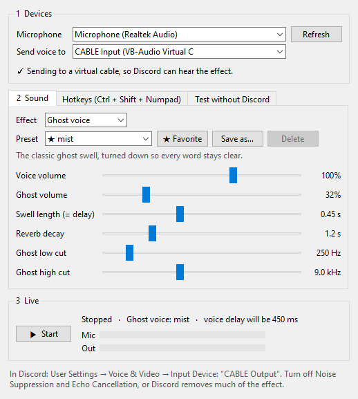

# ghostvoice

A ghostly voice filter for Discord, built on the **reverse → reverb → reverse**
trick: every word swells up out of a spectral wash *before* you say it.

## Download and run

Get the app from the latest successful **Build app** run on the
[Actions page](https://github.com/Kezov/OOP/actions/workflows/build-app.yml)
(open the run, scroll to **Artifacts**; you need to be signed in to GitHub):

| You have | Download | Start it |
|----------|----------|----------|
| Windows  | `GhostVoice-Windows` | unzip, double-click `GhostVoice.exe`. On "Windows protected your PC": **More info → Run anyway** (the app isn't code-signed). |
| macOS (Apple Silicon) | `GhostVoice-macOS` | unzip twice, right-click `GhostVoice.app` → **Open**. If refused: System Settings → Privacy & Security → **Open Anyway**. |
| Linux    | `GhostVoice-Linux` | `tar xzf GhostVoice-Linux.tar.gz && ./GhostVoice` (needs `sudo apt install libportaudio2`). |

**Or run it from the source code:** download this repository (Code → Download ZIP),
unzip, and double-click `GhostVoice.bat` (Windows) or `GhostVoice.command` (macOS;
on Linux run `./GhostVoice.command`). The first start sets everything up, which
needs [Python 3.9+](https://www.python.org/downloads/) and internet once.



In the app:

1. **Devices:** pick your microphone, and under *Send ghost voice to* your
   virtual cable (see below). The cable is picked automatically if it's installed.
2. **Sound:** pick a preset or move the sliders. Changes apply instantly, even while running.
3. **Start.** The meters show your mic and the ghost voice going out.

**Test without Discord:** press *Record 5 s*, say something, then *Play ghost*
and *Play original* (on your default speakers or headphones). Change the sound and
play again.

## How it works

The studio version of this effect flips a recording backwards, adds reverb,
and flips it forwards again, which puts the reverb tail *in front of* each sound.
A live mic can't be played backwards, but reversing commutes with convolution:

```
reverse( reverb( reverse(x) ) )  ==  x convolved with reverse(reverb_impulse)
```

So the filter convolves your mic with a **time-reversed reverb impulse response**,
which works in real time. The cost is a delay equal to the swell length (default
0.45 s), because the swell has to play before the word it leads into. The test
suite checks that the live filter matches the literal three-step version sample
for sample.

```
ghostvoice/
  ghost.py      the effect (live GhostFilter + literal offline version)
  convolver.py  low-latency partitioned FFT convolution
  ir.py         synthetic reverb generator / IR file loading
  realtime.py   mic -> filter -> output device (LiveEngine)
  presets.py    built-in sounds
  gui.py        the app window
  cli.py        command line
packaging/      PyInstaller recipe for the double-click app (built by GitHub Actions)
```

## Install as a Python package

Python 3.9+.

```bash
pip install -e .
ghostvoice gui        # the app; or use the command line below
# Linux only, if you see "PortAudio library not found":
sudo apt install libportaudio2 python3-tk
```

## Hooking it up to Discord

Discord can't load audio plugins, so ghostvoice plays the filtered voice into a
**virtual audio cable**, and Discord uses that cable as its microphone.
The app shows the right Discord setting for your cable once it's selected.

1. **Install a virtual cable**
   - Windows: [VB-Audio Virtual Cable](https://vb-audio.com/Cable/)
   - macOS: [BlackHole 2ch](https://existential.audio/blackhole/)
   - Linux (PulseAudio/PipeWire):
     ```bash
     pactl load-module module-null-sink sink_name=ghostvoice sink_properties=device.description=ghostvoice
     pactl load-module module-remap-source master=ghostvoice.monitor source_name=ghostmic source_properties=device.description=GhostMic
     ```
2. **In the app:** press Refresh, pick the cable (`CABLE Input`, `BlackHole 2ch`
   or `ghostvoice`) under *Send ghost voice to*, press Start. Or from the command line:
   find your devices with `ghostvoice devices`, then run the filter with your real
   mic as input and the cable as output:
   ```bash
   ghostvoice run -i "Microphone" -o "CABLE Input"   # Windows
   ghostvoice run -i "MacBook" -o "BlackHole"         # macOS
   ghostvoice run -o ghostvoice                       # Linux
   ```
   Names are matched by substring; device numbers work too. On Linux the
   PulseAudio/PipeWire device names and descriptions work as well.
3. **In Discord** → User Settings → Voice & Video:
   - Input Device: `CABLE Output` / `BlackHole 2ch` / `GhostMic`
   - Turn **off** Noise Suppression (Krisp) and Echo Cancellation: they treat the
     ghostly wash as noise and strip it out.
   - Lower the input sensitivity threshold, or use push-to-talk. Hold push-to-talk
     about half a second after you finish speaking, because of the delay.

To hear the effect yourself first, use the app's *Record / Play ghost* buttons,
or leave out `-o` to play it live through your speakers (use headphones, or it
will feed back).

## Presets

| Preset    | Sound | Delay |
|-----------|-------|-------|
| `normal`  | Your voice exactly as it is, no effect | none |
| `mist` (default) | The classic ghost swell, turned down so every word stays clear | 0.45 s |
| `breath`  | Airy breath around a clear voice; the easiest to understand | 0.35 s |
| `faint`   | Short, light swell | 0.3 s |
| `veil`    | Dark, soft cloud behind the voice | 0.4 s |
| `ghost`   | Full effect: the voice sinks into the wash | 0.45 s |
| `whisper` | Short and thin, voice partly buried | 0.3 s |
| `phantom` | Long, heavy swell; hard to understand | 0.7 s |
| `banshee` | Thin, shrieking wash with a very quiet voice | 0.6 s |

The mild presets (`mist`, `breath`, `faint`, `veil`) keep your voice at its normal
volume and put the wash 8-10 dB below it. On a speech test they scored 0.87-0.94 on
STOI, a standard speech-intelligibility measure (1.0 = as clear as the original),
against 0.44-0.67 for the strong ones.

With the ghost wash at 0 % (the `normal` preset, or the Ghost slider at 0) there is
no swell to wait for, so the voice goes straight through with no delay. Handy for
talking normally without changing Discord's input device.

## Tuning (command line)

| Option        | What it does                                              | Default |
|---------------|-----------------------------------------------------------|---------|
| `--preset`    | One of the presets above                                  | `mist`  |
| `--voice`     | Voice volume in % (100 = unchanged)                       | preset  |
| `--ghost`     | Ghostly wash volume in % of the voice level               | preset  |
| `--tail`      | Swell length in seconds. **Also the voice delay.**        | preset  |
| `--decay`     | Reverb decay (RT60). Longer = fuller, denser swell        | preset  |
| `--highpass`  | Thin out the wash below this Hz (0 = off)                 | preset  |
| `--lowpass`   | Darken the wash above this Hz (0 = off)                   | preset  |
| `--mix`, `--gain` | Lower-level alternative to `--voice`/`--ghost`: wet/dry crossfade and output gain in dB | preset |
| `--ir`        | Use your own reverb impulse response WAV                  | built-in|
| `--latency`   | Audio buffering in seconds; raise it if you hear dropouts | 0.06    |
| `--block`     | Audio block size in samples                               | 256     |

## Try it on a recording

```bash
ghostvoice file my_voice.wav ghostly.wav --preset phantom
```

## Development

```bash
pip install -e ".[dev]"
pytest                                       # app tests need Tk and a display (xvfb-run on Linux)
pyinstaller packaging/ghostvoice.spec        # build the app for this OS into dist/
```

Every push runs the tests and builds and self-tests the app on Windows, macOS and
Linux (`.github/workflows/build-app.yml`). Pushing a tag such as `v0.2.0` also
publishes the downloads as a GitHub Release.
